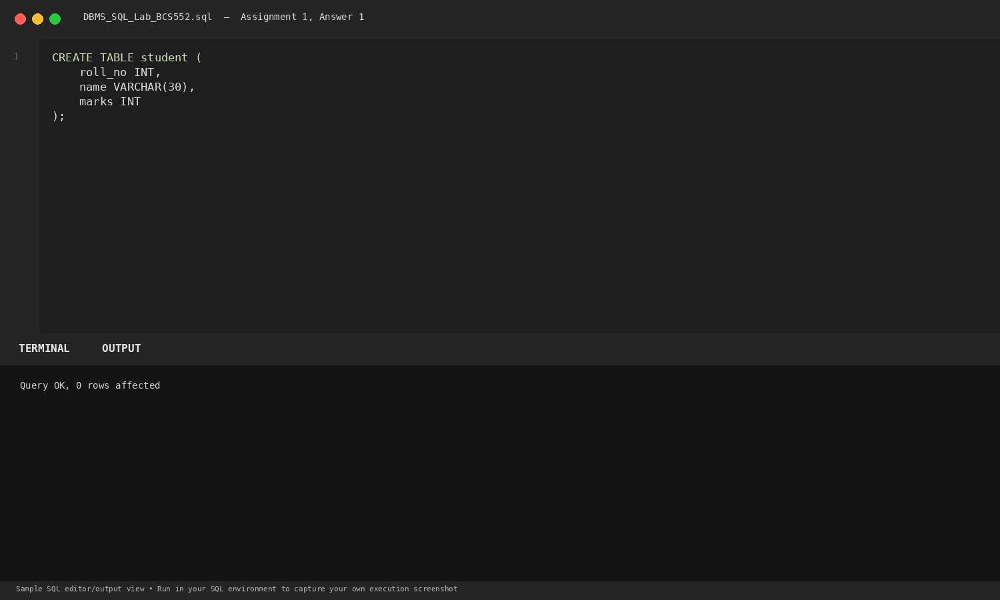
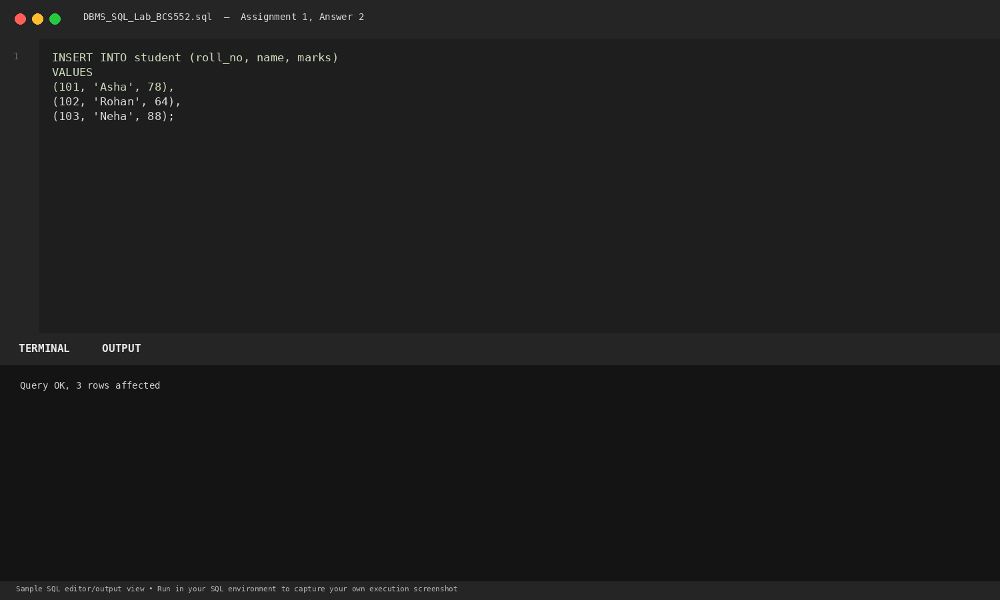
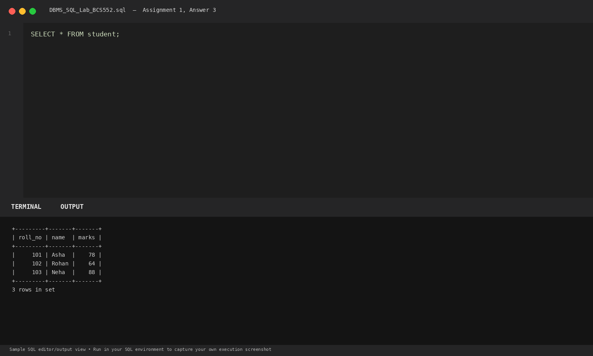

# Lab 1: Creating a Table and Adding Rows

**Course:** DBMS &amp; SQL Lab (BCS552)  
**Institution:** Invertis University Bareilly  
**Degree:** B.Tech CSE 5th Semester  
**Submitted By:** Usman Khan (Roll No.: 2410303518)  
**Submitted To:** Manish Choudhary  

---

## 🎯 Aim
Create a table, add three rows with one INSERT, and show the table.

## 🧠 Core Concepts
Data Definition Language (DDL) CREATE TABLE, Data Manipulation Language (DML) multi-row INSERT, and Data Query Language (DQL) SELECT *.

---

## 💻 SQL Tasks &amp; Solutions

### Task 1: Create the student table

**SQL Statement:**
```sql
CREATE TABLE student (
    roll_no INT,
    name VARCHAR(30),
    marks INT
);
```

**Expected Output:**
```text
Query OK, 0 rows affected
```

**Explanation:**  
Creates a relation named student with roll_no (integer), name (variable character string up to 30 characters), and marks (integer).

**Execution Output Screenshot:**  


---
### Task 2: Insert three rows in one statement

**SQL Statement:**
```sql
INSERT INTO student (roll_no, name, marks)
VALUES
(101, 'Asha', 78),
(102, 'Rohan', 64),
(103, 'Neha', 88);
```

**Expected Output:**
```text
Query OK, 3 rows affected
```

**Explanation:**  
Inserts three tuples in a single atomic transaction, minimizing network round-trips and ensuring batch consistency.

**Execution Output Screenshot:**  


---
### Task 3: Display all rows

**SQL Statement:**
```sql
SELECT * FROM student;
```

**Expected Output:**
```text
+---------+-------+-------+
| roll_no | name  | marks |
+---------+-------+-------+
|     101 | Asha  |    78 |
|     102 | Rohan |    64 |
|     103 | Neha  |    88 |
+---------+-------+-------+
3 rows in set
```

**Explanation:**  
The asterisk (*) wildcard projects all columns from the student relation.

**Execution Output Screenshot:**  


---

## 🚀 How to Execute
1. Open MySQL / MariaDB terminal or any SQL client:
   ```bash
   mysql -u username -p
   ```
2. Execute the included SQL file:
   ```sql
   source queries.sql;
   ```
3. Or open `index.html` in your web browser to inspect the visual laboratory report.
