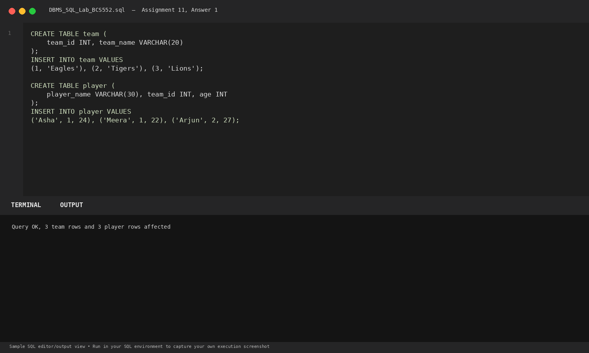
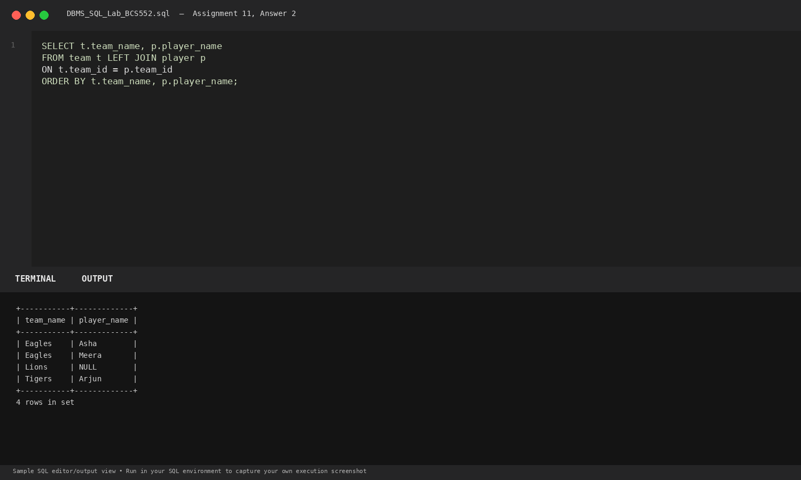
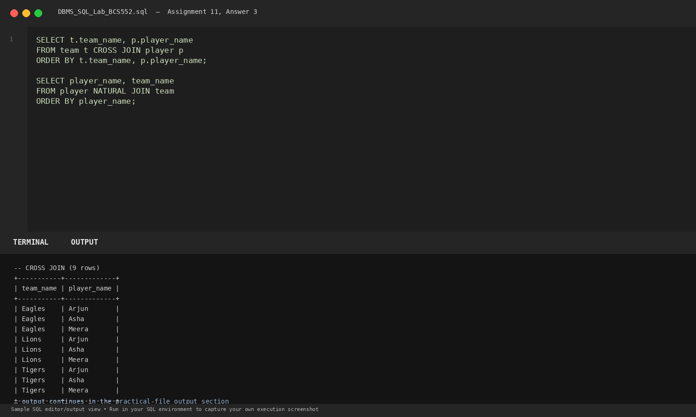

# Lab 11: Other Kinds of Joins

**Course:** DBMS &amp; SQL Lab (BCS552)  
**Institution:** Invertis University Bareilly  
**Degree:** B.Tech CSE 5th Semester  
**Submitted By:** Usman Khan (Roll No.: 2410303518)  
**Submitted To:** Manish Choudhary  

---

## 🎯 Aim
Use LEFT JOIN, CROSS JOIN and NATURAL JOIN.

## 🧠 Core Concepts
Outer joins (LEFT JOIN preserving left unmatched rows as NULL), Cartesian product (CROSS JOIN), and schema-inferred NATURAL JOIN.

---

## 💻 SQL Tasks &amp; Solutions

### Task 1: Set up team and player tables

**SQL Statement:**
```sql
CREATE TABLE team (
    team_id INT, team_name VARCHAR(20)
);

INSERT INTO team VALUES
(1, 'Eagles'), (2, 'Tigers'), (3, 'Lions');

CREATE TABLE player (
    player_name VARCHAR(30), team_id INT, age INT
);

INSERT INTO player VALUES
('Asha', 1, 24), ('Meera', 1, 22), ('Arjun', 2, 27);
```

**Expected Output:**
```text
Query OK, 3 team rows and 3 player rows affected
```

**Explanation:**  
Initializes sports teams and players where team 3 (Lions) currently has no assigned players.

**Execution Output Screenshot:**  


---
### Task 2: Use LEFT JOIN

**SQL Statement:**
```sql
SELECT t.team_name, p.player_name
FROM team t LEFT JOIN player p
ON t.team_id = p.team_id
ORDER BY t.team_name, p.player_name;
```

**Expected Output:**
```text
+-----------+-------------+
| team_name | player_name |
+-----------+-------------+
| Eagles    | Asha        |
| Eagles    | Meera       |
| Lions     | NULL        |
| Tigers    | Arjun       |
+-----------+-------------+
4 rows in set
```

**Explanation:**  
LEFT JOIN returns all rows from team; Lions has no matching player, yielding NULL in player columns.

**Execution Output Screenshot:**  


---
### Task 3: Use CROSS JOIN and NATURAL JOIN

**SQL Statement:**
```sql
SELECT t.team_name, p.player_name
FROM team t CROSS JOIN player p
ORDER BY t.team_name, p.player_name;

SELECT player_name, team_name
FROM player NATURAL JOIN team
ORDER BY player_name;
```

**Expected Output:**
```text
-- CROSS JOIN (9 rows)
+-----------+-------------+
| team_name | player_name |
+-----------+-------------+
| Eagles    | Arjun       |
| Eagles    | Asha        |
| Eagles    | Meera       |
| Lions     | Arjun       |
| Lions     | Asha        |
| Lions     | Meera       |
| Tigers    | Arjun       |
| Tigers    | Asha        |
| Tigers    | Meera       |
+-----------+-------------+
9 rows in set

-- NATURAL JOIN
+-------------+-----------+
| player_name | team_name |
+-------------+-----------+
| Arjun       | Tigers    |
| Asha        | Eagles    |
| Meera       | Eagles    |
+-------------+-----------+
3 rows in set
```

**Explanation:**  
CROSS JOIN produces a Cartesian product (3 x 3 = 9 tuples). NATURAL JOIN matches automatically on columns with identical names (team_id).

**Execution Output Screenshot:**  


---

## 🚀 How to Execute
1. Open MySQL / MariaDB terminal or any SQL client:
   ```bash
   mysql -u username -p
   ```
2. Execute the included SQL file:
   ```sql
   source queries.sql;
   ```
3. Or open `index.html` in your web browser to inspect the visual laboratory report.
