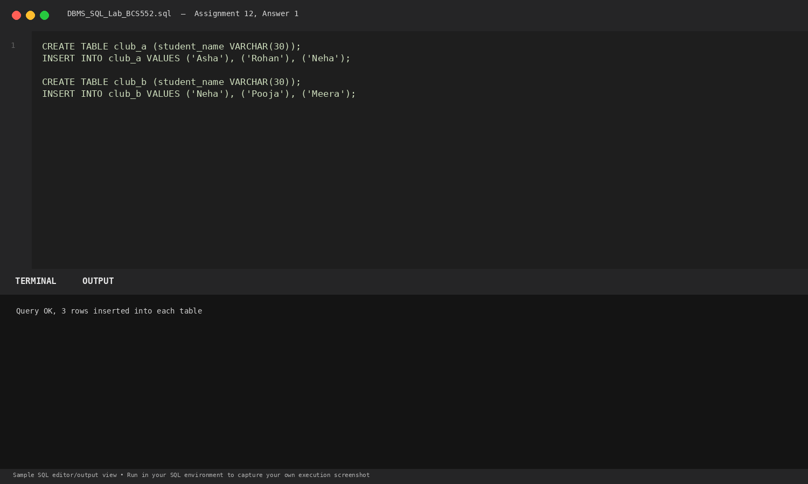
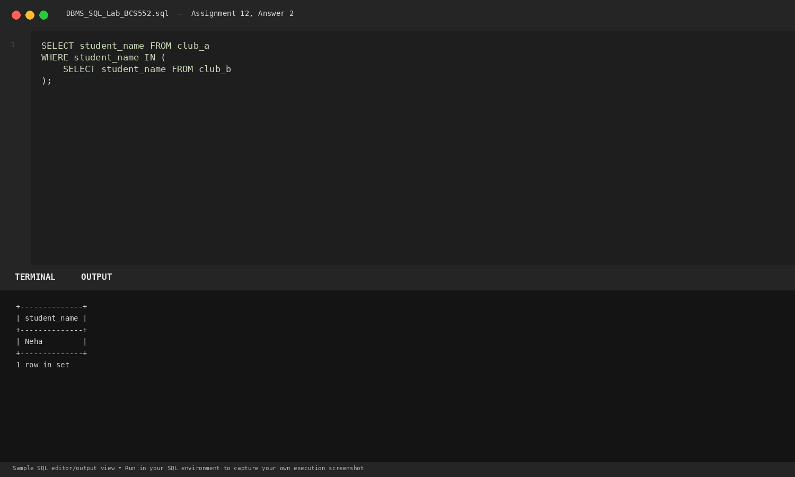
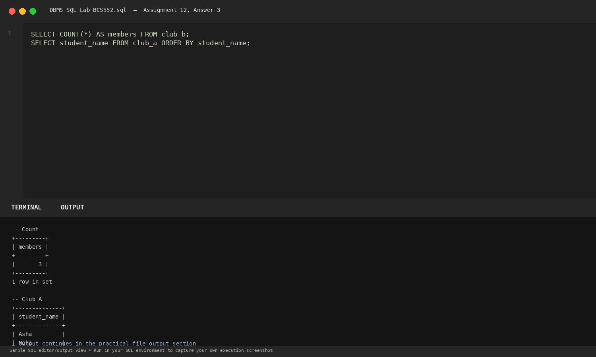

# Lab 12: Using a Subquery

**Course:** DBMS &amp; SQL Lab (BCS552)  
**Institution:** Invertis University Bareilly  
**Degree:** B.Tech CSE 5th Semester  
**Submitted By:** Usman Khan (Roll No.: 2410303518)  
**Submitted To:** Manish Choudhary  

---

## 🎯 Aim
Use a query inside another query with IN.

## 🧠 Core Concepts
Nested subqueries (sub-selects), membership checking with IN, independent subqueries, and scalar aggregation.

---

## 💻 SQL Tasks &amp; Solutions

### Task 1: Set up club tables

**SQL Statement:**
```sql
CREATE TABLE club_a (student_name VARCHAR(30));
INSERT INTO club_a VALUES ('Asha'), ('Rohan'), ('Neha');

CREATE TABLE club_b (student_name VARCHAR(30));
INSERT INTO club_b VALUES ('Neha'), ('Pooja'), ('Meera');
```

**Expected Output:**
```text
Query OK, 3 rows inserted into each table
```

**Explanation:**  
Sets up two distinct club rosters to analyze membership overlap.

**Execution Output Screenshot:**  


---
### Task 2: Find names common to both clubs with a subquery

**SQL Statement:**
```sql
SELECT student_name FROM club_a
WHERE student_name IN (
    SELECT student_name FROM club_b
);
```

**Expected Output:**
```text
+--------------+
| student_name |
+--------------+
| Neha         |
+--------------+
1 row in set
```

**Explanation:**  
The inner query selects student names from club_b; the outer query evaluates club_a students against that set.

**Execution Output Screenshot:**  


---
### Task 3: Count club B members and list club A

**SQL Statement:**
```sql
SELECT COUNT(*) AS members FROM club_b;
SELECT student_name FROM club_a ORDER BY student_name;
```

**Expected Output:**
```text
-- Count
+---------+
| members |
+---------+
|       3 |
+---------+
1 row in set

-- Club A
+--------------+
| student_name |
+--------------+
| Asha         |
| Neha         |
| Rohan        |
+--------------+
3 rows in set
```

**Explanation:**  
Counts club_b members and produces an ordered list of students enrolled in club_a.

**Execution Output Screenshot:**  


---

## 🚀 How to Execute
1. Open MySQL / MariaDB terminal or any SQL client:
   ```bash
   mysql -u username -p
   ```
2. Execute the included SQL file:
   ```sql
   source queries.sql;
   ```
3. Or open `index.html` in your web browser to inspect the visual laboratory report.
