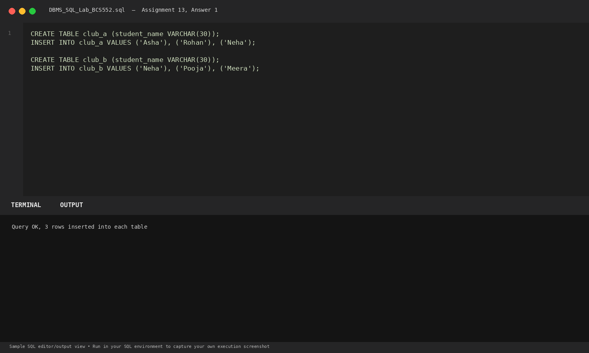
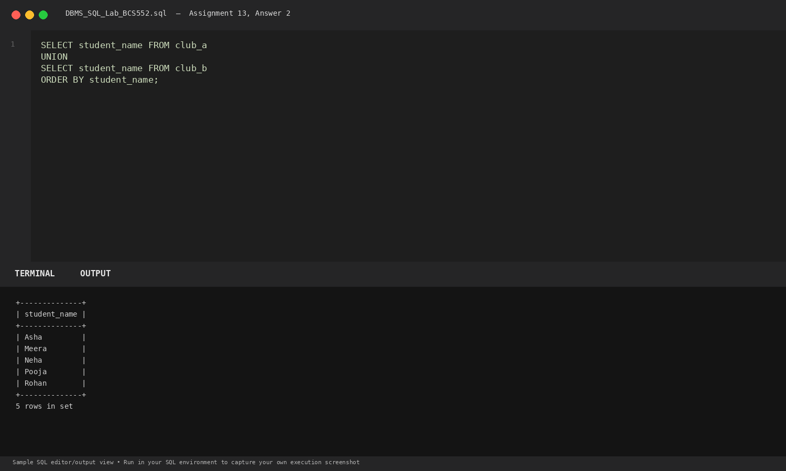
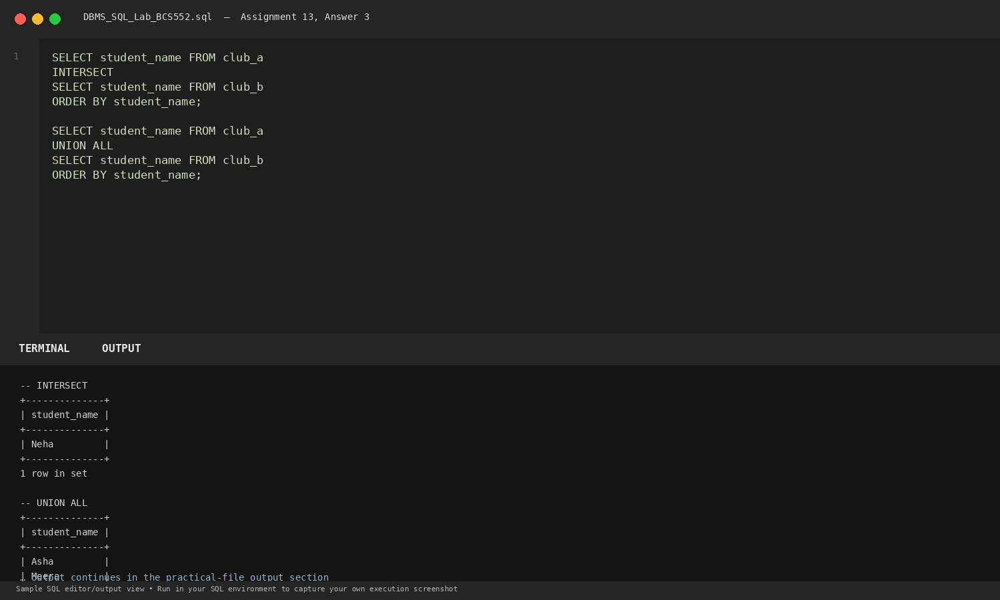

# Lab 13: UNION and INTERSECT

**Course:** DBMS &amp; SQL Lab (BCS552)  
**Institution:** Invertis University Bareilly  
**Degree:** B.Tech CSE 5th Semester  
**Submitted By:** Usman Khan (Roll No.: 2410303518)  
**Submitted To:** Manish Choudhary  

---

## 🎯 Aim
Combine two lists and find names present in both lists.

## 🧠 Core Concepts
Set operations in SQL: UNION (combines distinct records), INTERSECT (finds common records), and UNION ALL (combines including duplicates).

---

## 💻 SQL Tasks &amp; Solutions

### Task 1: Set up club tables

**SQL Statement:**
```sql
CREATE TABLE club_a (student_name VARCHAR(30));
INSERT INTO club_a VALUES ('Asha'), ('Rohan'), ('Neha');

CREATE TABLE club_b (student_name VARCHAR(30));
INSERT INTO club_b VALUES ('Neha'), ('Pooja'), ('Meera');
```

**Expected Output:**
```text
Query OK, 3 rows inserted into each table
```

**Explanation:**  
Initializes two relations with student enrollments.

**Execution Output Screenshot:**  


---
### Task 2: Combine names once using UNION

**SQL Statement:**
```sql
SELECT student_name FROM club_a
UNION
SELECT student_name FROM club_b
ORDER BY student_name;
```

**Expected Output:**
```text
+--------------+
| student_name |
+--------------+
| Asha         |
| Meera        |
| Neha         |
| Pooja        |
| Rohan        |
+--------------+
5 rows in set
```

**Explanation:**  
UNION merges both result sets and automatically deduplicates values ('Neha' appears only once).

**Execution Output Screenshot:**  


---
### Task 3: Find common names and include duplicates with UNION ALL

**SQL Statement:**
```sql
SELECT student_name FROM club_a
INTERSECT
SELECT student_name FROM club_b
ORDER BY student_name;

SELECT student_name FROM club_a
UNION ALL
SELECT student_name FROM club_b
ORDER BY student_name;
```

**Expected Output:**
```text
-- INTERSECT
+--------------+
| student_name |
+--------------+
| Neha         |
+--------------+
1 row in set

-- UNION ALL
+--------------+
| student_name |
+--------------+
| Asha         |
| Meera        |
| Neha         |
| Neha         |
| Pooja        |
| Rohan        |
+--------------+
6 rows in set
```

**Explanation:**  
INTERSECT returns only records present in both sets. UNION ALL concatenates all rows without removing duplicates.

**Execution Output Screenshot:**  


---

## 🚀 How to Execute
1. Open MySQL / MariaDB terminal or any SQL client:
   ```bash
   mysql -u username -p
   ```
2. Execute the included SQL file:
   ```sql
   source queries.sql;
   ```
3. Or open `index.html` in your web browser to inspect the visual laboratory report.
