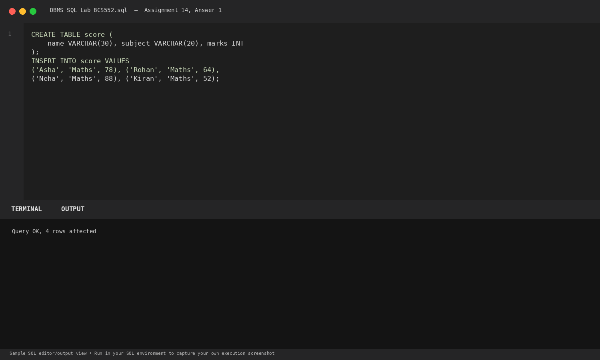
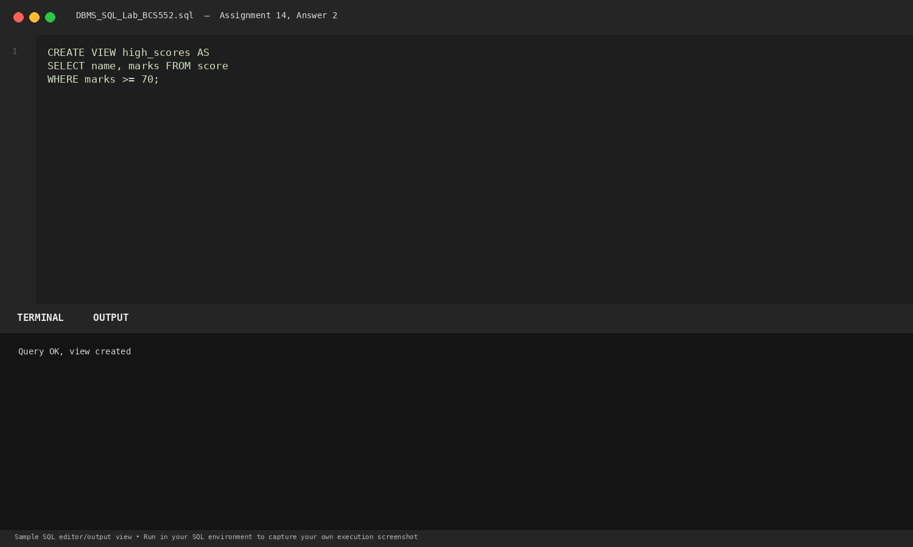
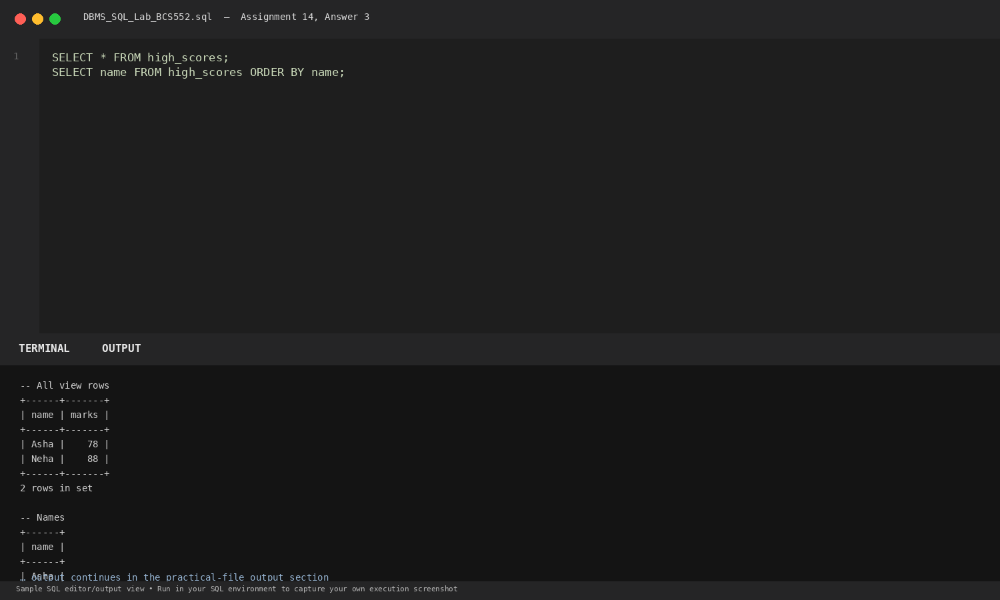

# Lab 14: Creating and Using a View

**Course:** DBMS &amp; SQL Lab (BCS552)  
**Institution:** Invertis University Bareilly  
**Degree:** B.Tech CSE 5th Semester  
**Submitted By:** Usman Khan (Roll No.: 2410303518)  
**Submitted To:** Manish Choudhary  

---

## 🎯 Aim
Save a query as a view, then read the view.

## 🧠 Core Concepts
Virtual tables with CREATE VIEW, simplifying complex queries, access control abstraction, and querying views like base tables.

---

## 💻 SQL Tasks &amp; Solutions

### Task 1: Set up the score table

**SQL Statement:**
```sql
CREATE TABLE score (
    name VARCHAR(30), subject VARCHAR(20), marks INT
);

INSERT INTO score VALUES
('Asha', 'Maths', 78), ('Rohan', 'Maths', 64),
('Neha', 'Maths', 88), ('Kiran', 'Maths', 52);
```

**Expected Output:**
```text
Query OK, 4 rows affected
```

**Explanation:**  
Creates a score table recording subject test marks.

**Execution Output Screenshot:**  


---
### Task 2: Create the high_scores view

**SQL Statement:**
```sql
CREATE VIEW high_scores AS
SELECT name, marks FROM score
WHERE marks >= 70;
```

**Expected Output:**
```text
Query OK, view created
```

**Explanation:**  
Creates a virtual view high_scores containing students scoring 70 or above.

**Execution Output Screenshot:**  


---
### Task 3: Display all rows and names from the view

**SQL Statement:**
```sql
SELECT * FROM high_scores;
SELECT name FROM high_scores ORDER BY name;
```

**Expected Output:**
```text
-- All view rows
+------+-------+
| name | marks |
+------+-------+
| Asha |    78 |
| Neha |    88 |
+------+-------+
2 rows in set

-- Names
+------+
| name |
+------+
| Asha |
| Neha |
+------+
2 rows in set
```

**Explanation:**  
Queries high_scores like a normal table. The database engine transparently resolves the view definition at runtime.

**Execution Output Screenshot:**  


---

## 🚀 How to Execute
1. Open MySQL / MariaDB terminal or any SQL client:
   ```bash
   mysql -u username -p
   ```
2. Execute the included SQL file:
   ```sql
   source queries.sql;
   ```
3. Or open `index.html` in your web browser to inspect the visual laboratory report.
