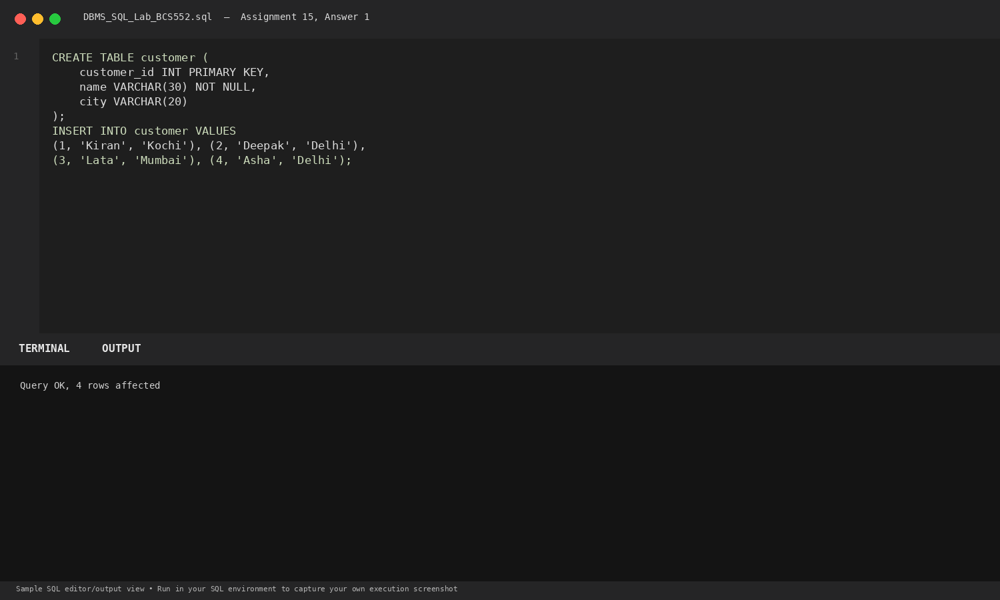
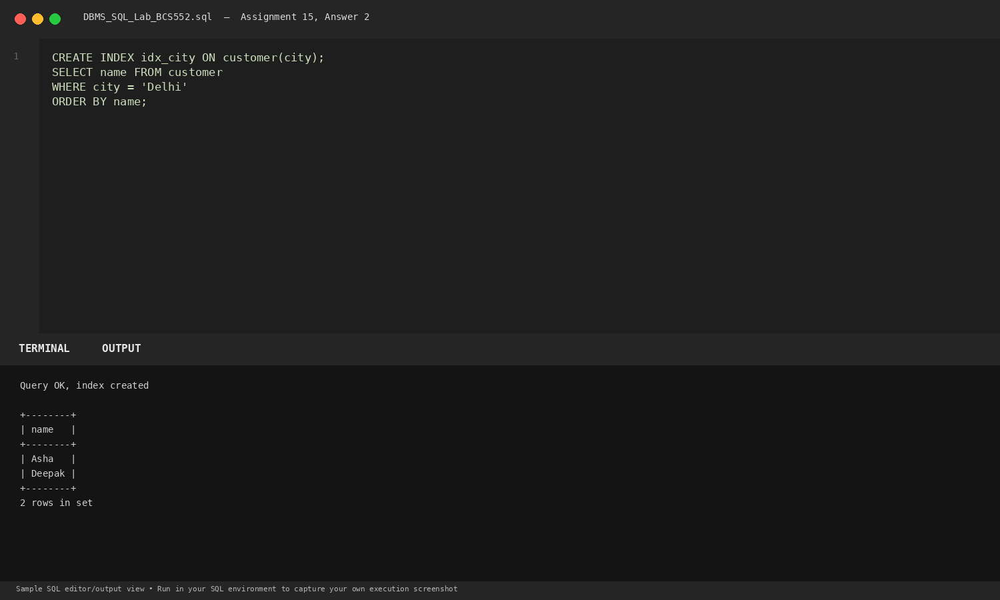
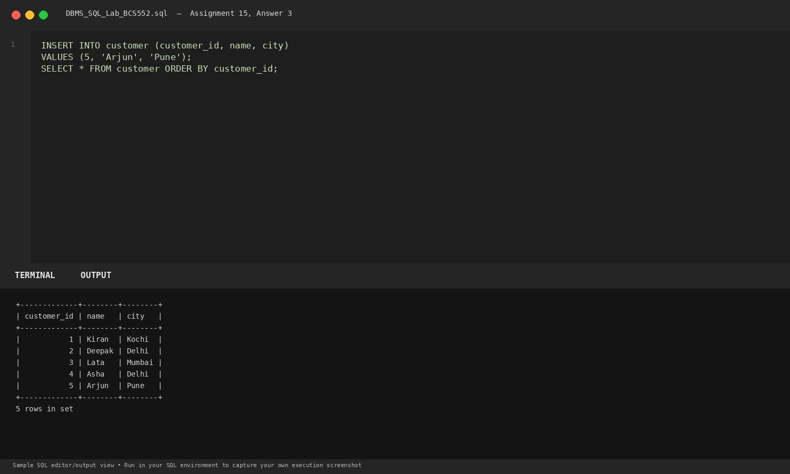

# Lab 15: Indexes and Adding a Row

**Course:** DBMS &amp; SQL Lab (BCS552)  
**Institution:** Invertis University Bareilly  
**Degree:** B.Tech CSE 5th Semester  
**Submitted By:** Usman Khan (Roll No.: 2410303518)  
**Submitted To:** Manish Choudhary  

---

## 🎯 Aim
Create an index, read rows by city and add a customer.

## 🧠 Core Concepts
Database indexing with CREATE INDEX, optimizing lookup performance on searchable columns, primary keys, and table maintenance.

---

## 💻 SQL Tasks &amp; Solutions

### Task 1: Set up the customer table

**SQL Statement:**
```sql
CREATE TABLE customer (
    customer_id INT PRIMARY KEY,
    name VARCHAR(30) NOT NULL,
    city VARCHAR(20)
);

INSERT INTO customer VALUES
(1, 'Kiran', 'Kochi'), (2, 'Deepak', 'Delhi'),
(3, 'Lata', 'Mumbai'), (4, 'Asha', 'Delhi');
```

**Expected Output:**
```text
Query OK, 4 rows affected
```

**Explanation:**  
Defines customer table with PRIMARY KEY and NOT NULL constraints, populated with 4 initial entries.

**Execution Output Screenshot:**  


---
### Task 2: Create an index and find Delhi customers

**SQL Statement:**
```sql
CREATE INDEX idx_city ON customer(city);

SELECT name FROM customer
WHERE city = 'Delhi'
ORDER BY name;
```

**Expected Output:**
```text
Query OK, index created

+--------+
| name   |
+--------+
| Asha   |
| Deepak |
+--------+
2 rows in set
```

**Explanation:**  
CREATE INDEX builds a B-tree index on the city attribute, accelerating equality filtering queries.

**Execution Output Screenshot:**  


---
### Task 3: Insert a new customer and display the table

**SQL Statement:**
```sql
INSERT INTO customer (customer_id, name, city)
VALUES (5, 'Arjun', 'Pune');

SELECT * FROM customer ORDER BY customer_id;
```

**Expected Output:**
```text
+-------------+--------+--------+
| customer_id | name   | city   |
+-------------+--------+--------+
|           1 | Kiran  | Kochi  |
|           2 | Deepak | Delhi  |
|           3 | Lata   | Mumbai |
|           4 | Asha   | Delhi  |
|           5 | Arjun  | Pune   |
+-------------+--------+--------+
5 rows in set
```

**Explanation:**  
Inserts a new tuple into customer; the index on city is updated automatically by the RDBMS.

**Execution Output Screenshot:**  


---

## 🚀 How to Execute
1. Open MySQL / MariaDB terminal or any SQL client:
   ```bash
   mysql -u username -p
   ```
2. Execute the included SQL file:
   ```sql
   source queries.sql;
   ```
3. Or open `index.html` in your web browser to inspect the visual laboratory report.
