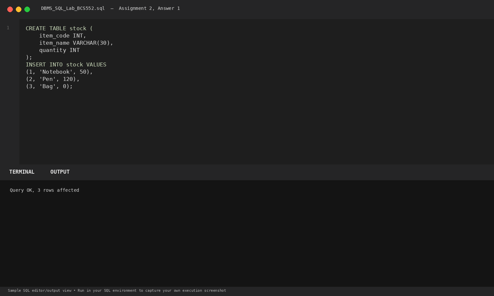
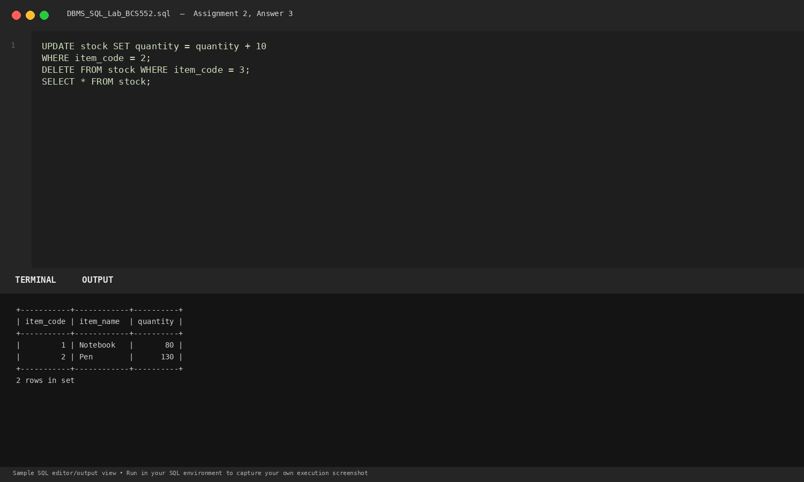
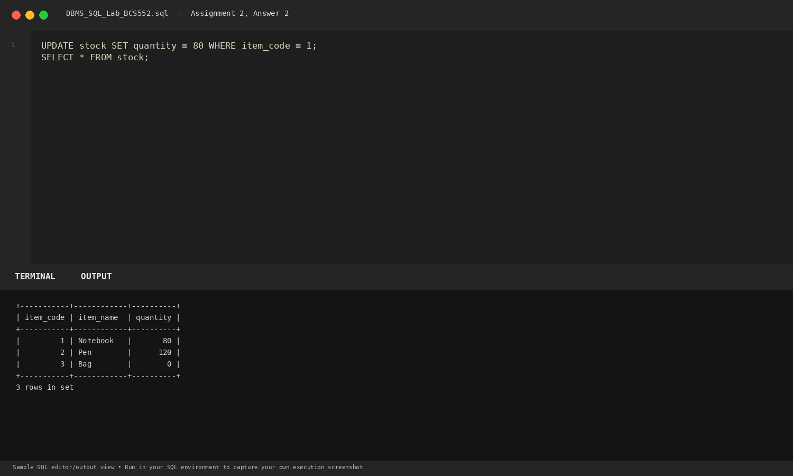

# Lab 2: Updating and Deleting Rows

**Course:** DBMS &amp; SQL Lab (BCS552)  
**Institution:** Invertis University Bareilly  
**Degree:** B.Tech CSE 5th Semester  
**Submitted By:** Usman Khan (Roll No.: 2410303518)  
**Submitted To:** Manish Choudhary  

---

## 🎯 Aim
Change values in rows, then delete a row and check the table after each step.

## 🧠 Core Concepts
DML UPDATE with SET clause, arithmetic expressions in UPDATE, row removal with DELETE, and filtering with WHERE.

---

## 💻 SQL Tasks &amp; Solutions

### Task 1: Set up the stock table

**SQL Statement:**
```sql
CREATE TABLE stock (
    item_code INT,
    item_name VARCHAR(30),
    quantity INT
);

INSERT INTO stock VALUES
(1, 'Notebook', 50),
(2, 'Pen', 120),
(3, 'Bag', 0);
```

**Expected Output:**
```text
Query OK, 3 rows affected
```

**Explanation:**  
Defines an inventory tracking schema stock and populates it with 3 initial items.

**Execution Output Screenshot:**  


---
### Task 2: Change quantity of item 1 to 80

**SQL Statement:**
```sql
UPDATE stock SET quantity = 80 WHERE item_code = 1;
SELECT * FROM stock;
```

**Expected Output:**
```text
+-----------+------------+----------+
| item_code | item_name  | quantity |
+-----------+------------+----------+
|         1 | Notebook   |       80 |
|         2 | Pen        |      120 |
|         3 | Bag        |        0 |
+-----------+------------+----------+
3 rows in set
```

**Explanation:**  
Updates the quantity attribute to 80 strictly for the tuple matching item_code = 1.

**Execution Output Screenshot:**  


---
### Task 3: Add 10 to item 2 and delete item 3

**SQL Statement:**
```sql
UPDATE stock SET quantity = quantity + 10
WHERE item_code = 2;

DELETE FROM stock WHERE item_code = 3;

SELECT * FROM stock;
```

**Expected Output:**
```text
+-----------+------------+----------+
| item_code | item_name  | quantity |
+-----------+------------+----------+
|         1 | Notebook   |       80 |
|         2 | Pen        |      130 |
+-----------+------------+----------+
2 rows in set
```

**Explanation:**  
Increments quantity by 10 for item_code 2 using an in-place expression, then removes out-of-stock item_code 3.

**Execution Output Screenshot:**  


---

## 🚀 How to Execute
1. Open MySQL / MariaDB terminal or any SQL client:
   ```bash
   mysql -u username -p
   ```
2. Execute the included SQL file:
   ```sql
   source queries.sql;
   ```
3. Or open `index.html` in your web browser to inspect the visual laboratory report.
