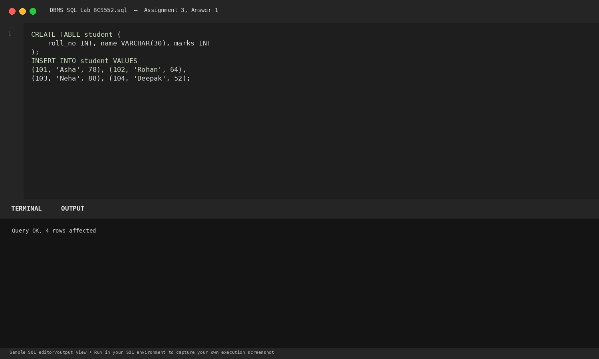
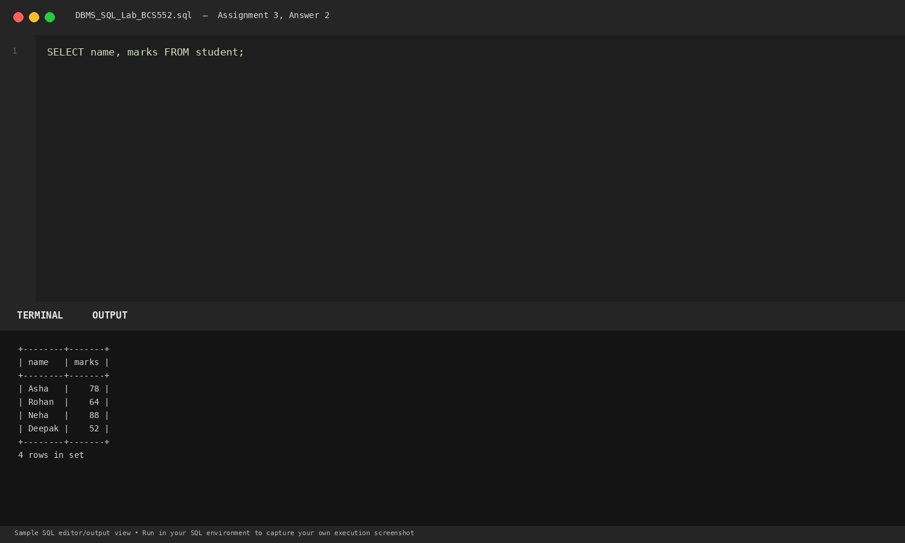
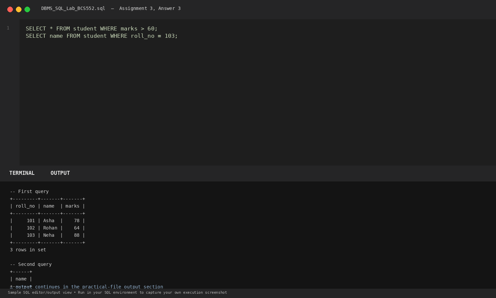

# Lab 3: Selecting Columns and Rows with WHERE

**Course:** DBMS &amp; SQL Lab (BCS552)  
**Institution:** Invertis University Bareilly  
**Degree:** B.Tech CSE 5th Semester  
**Submitted By:** Usman Khan (Roll No.: 2410303518)  
**Submitted To:** Manish Choudhary  

---

## 🎯 Aim
Show selected columns and filter rows using WHERE.

## 🧠 Core Concepts
Vertical projection (selecting specific columns) and horizontal selection (row filtering with WHERE comparison operators).

---

## 💻 SQL Tasks &amp; Solutions

### Task 1: Set up the student table

**SQL Statement:**
```sql
CREATE TABLE student (
    roll_no INT, name VARCHAR(30), marks INT
);

INSERT INTO student VALUES
(101, 'Asha', 78), (102, 'Rohan', 64),
(103, 'Neha', 88), (104, 'Deepak', 52);
```

**Expected Output:**
```text
Query OK, 4 rows affected
```

**Explanation:**  
Populates the student table with 4 records to evaluate filtering conditions.

**Execution Output Screenshot:**  


---
### Task 2: Show name and marks

**SQL Statement:**
```sql
SELECT name, marks FROM student;
```

**Expected Output:**
```text
+--------+-------+
| name   | marks |
+--------+-------+
| Asha   |    78 |
| Rohan  |    64 |
| Neha   |    88 |
| Deepak |    52 |
+--------+-------+
4 rows in set
```

**Explanation:**  
Projects only the name and marks attributes, omitting the roll_no column.

**Execution Output Screenshot:**  


---
### Task 3: Show students scoring above 60 and roll number 103

**SQL Statement:**
```sql
SELECT * FROM student WHERE marks > 60;
SELECT name FROM student WHERE roll_no = 103;
```

**Expected Output:**
```text
-- First query: marks > 60
+---------+-------+-------+
| roll_no | name  | marks |
+---------+-------+-------+
|     101 | Asha  |    78 |
|     102 | Rohan |    64 |
|     103 | Neha  |    88 |
+---------+-------+-------+
3 rows in set

-- Second query: roll_no = 103
+------+
| name |
+------+
| Neha |
+------+
1 row in set
```

**Explanation:**  
Filters rows based on numeric comparison (> 60) and exact key equality (= 103).

**Execution Output Screenshot:**  


---

## 🚀 How to Execute
1. Open MySQL / MariaDB terminal or any SQL client:
   ```bash
   mysql -u username -p
   ```
2. Execute the included SQL file:
   ```sql
   source queries.sql;
   ```
3. Or open `index.html` in your web browser to inspect the visual laboratory report.
