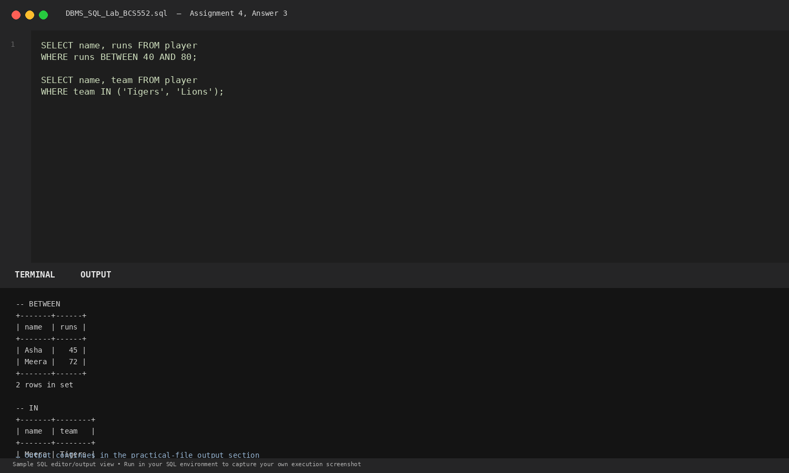

# Lab 4: Combining Conditions

**Course:** DBMS &amp; SQL Lab (BCS552)  
**Institution:** Invertis University Bareilly  
**Degree:** B.Tech CSE 5th Semester  
**Submitted By:** Usman Khan (Roll No.: 2410303518)  
**Submitted To:** Manish Choudhary  

---

## 🎯 Aim
Combine conditions with AND, BETWEEN and IN.

## 🧠 Core Concepts
Logical operators (AND), range filtering with BETWEEN ... AND, and discrete set membership with IN.

---

## 💻 SQL Tasks &amp; Solutions

### Task 1: Set up the player table

**SQL Statement:**
```sql
CREATE TABLE player (
    name VARCHAR(30), team VARCHAR(20), runs INT
);

INSERT INTO player VALUES
('Asha', 'Eagles', 45), ('Meera', 'Tigers', 72),
('Arjun', 'Eagles', 30), ('Kiran', 'Lions', 88);
```

**Expected Output:**
```text
Query OK, 4 rows affected
```

**Explanation:**  
Creates sports player statistics table with player name, team affiliation, and total runs.

**Execution Output Screenshot:**  


---
### Task 2: Eagles players with more than 35 runs

**SQL Statement:**
```sql
SELECT name, runs FROM player
WHERE team = 'Eagles' AND runs > 35;
```

**Expected Output:**
```text
+------+------+
| name | runs |
+------+------+
| Asha |   45 |
+------+------+
1 row in set
```

**Explanation:**  
Uses logical AND requiring both conditions (team is Eagles and runs > 35) to evaluate to TRUE.

**Execution Output Screenshot:**  


---
### Task 3: Use BETWEEN and IN

**SQL Statement:**
```sql
SELECT name, runs FROM player
WHERE runs BETWEEN 40 AND 80;

SELECT name, team FROM player
WHERE team IN ('Tigers', 'Lions');
```

**Expected Output:**
```text
-- BETWEEN query
+-------+------+
| name  | runs |
+-------+------+
| Asha  |   45 |
| Meera |   72 |
+-------+------+
2 rows in set

-- IN query
+-------+--------+
| name  | team   |
+-------+--------+
| Meera | Tigers |
| Kiran | Lions  |
+-------+--------+
2 rows in set
```

**Explanation:**  
BETWEEN specifies an inclusive range [40, 80]. IN checks if an attribute matches any value within a given set.

**Execution Output Screenshot:**  


---

## 🚀 How to Execute
1. Open MySQL / MariaDB terminal or any SQL client:
   ```bash
   mysql -u username -p
   ```
2. Execute the included SQL file:
   ```sql
   source queries.sql;
   ```
3. Or open `index.html` in your web browser to inspect the visual laboratory report.
