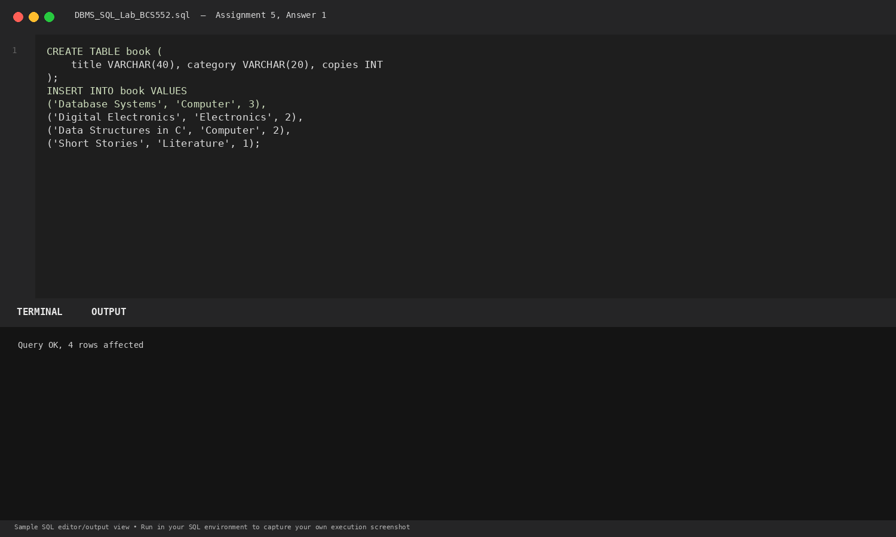
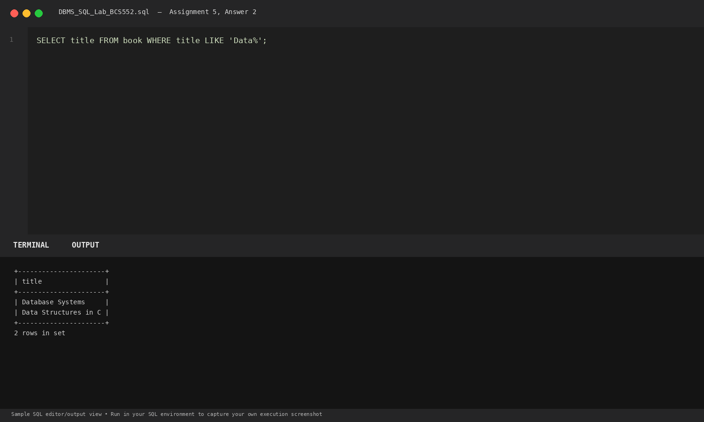
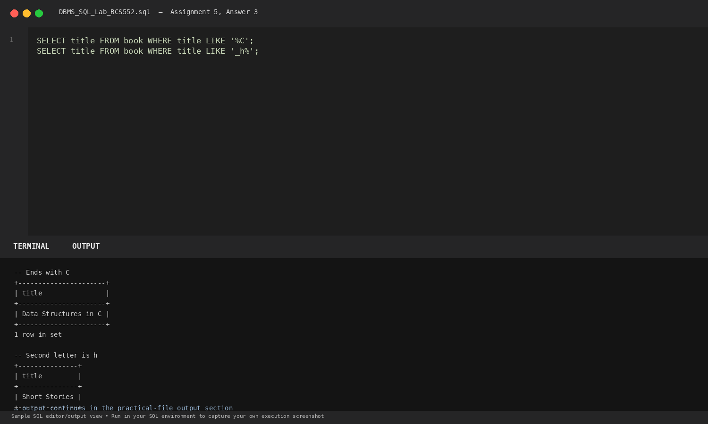

# Lab 5: Pattern Matching with LIKE

**Course:** DBMS &amp; SQL Lab (BCS552)  
**Institution:** Invertis University Bareilly  
**Degree:** B.Tech CSE 5th Semester  
**Submitted By:** Usman Khan (Roll No.: 2410303518)  
**Submitted To:** Manish Choudhary  

---

## 🎯 Aim
Find titles that match patterns with LIKE.

## 🧠 Core Concepts
Pattern matching with LIKE, wildcard character % (zero or more characters), and _ (single character match).

---

## 💻 SQL Tasks &amp; Solutions

### Task 1: Set up the book table

**SQL Statement:**
```sql
CREATE TABLE book (
    title VARCHAR(40), category VARCHAR(20), copies INT
);

INSERT INTO book VALUES
('Database Systems', 'Computer', 3),
('Digital Electronics', 'Electronics', 2),
('Data Structures in C', 'Computer', 2),
('Short Stories', 'Literature', 1);
```

**Expected Output:**
```text
Query OK, 4 rows affected
```

**Explanation:**  
Creates a library catalogue table with book titles, categories, and inventory copies.

**Execution Output Screenshot:**  


---
### Task 2: Titles starting with Data

**SQL Statement:**
```sql
SELECT title FROM book WHERE title LIKE 'Data%';
```

**Expected Output:**
```text
+----------------------+
| title                |
+----------------------+
| Database Systems     |
| Data Structures in C |
+----------------------+
2 rows in set
```

**Explanation:**  
'Data%' matches any string starting with 'Data' followed by any sequence of characters.

**Execution Output Screenshot:**  


---
### Task 3: Titles ending with C and second letter h

**SQL Statement:**
```sql
SELECT title FROM book WHERE title LIKE '%C';
SELECT title FROM book WHERE title LIKE '_h%';
```

**Expected Output:**
```text
-- Ends with C
+----------------------+
| title                |
+----------------------+
| Data Structures in C |
+----------------------+
1 row in set

-- Second letter is h
+---------------+
| title         |
+---------------+
| Short Stories |
+---------------+
1 row in set
```

**Explanation:**  
'%C' matches strings terminating with capital 'C'. '_h%' matches any single first character followed immediately by 'h'.

**Execution Output Screenshot:**  


---

## 🚀 How to Execute
1. Open MySQL / MariaDB terminal or any SQL client:
   ```bash
   mysql -u username -p
   ```
2. Execute the included SQL file:
   ```sql
   source queries.sql;
   ```
3. Or open `index.html` in your web browser to inspect the visual laboratory report.
