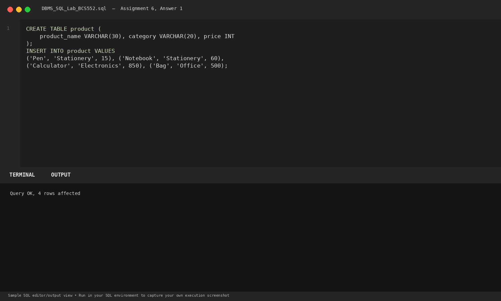
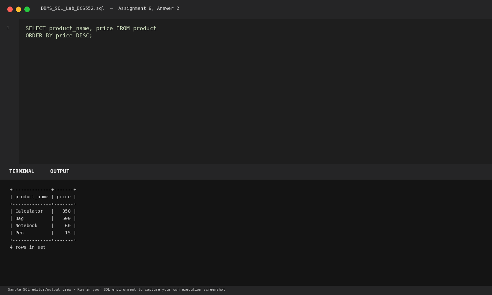
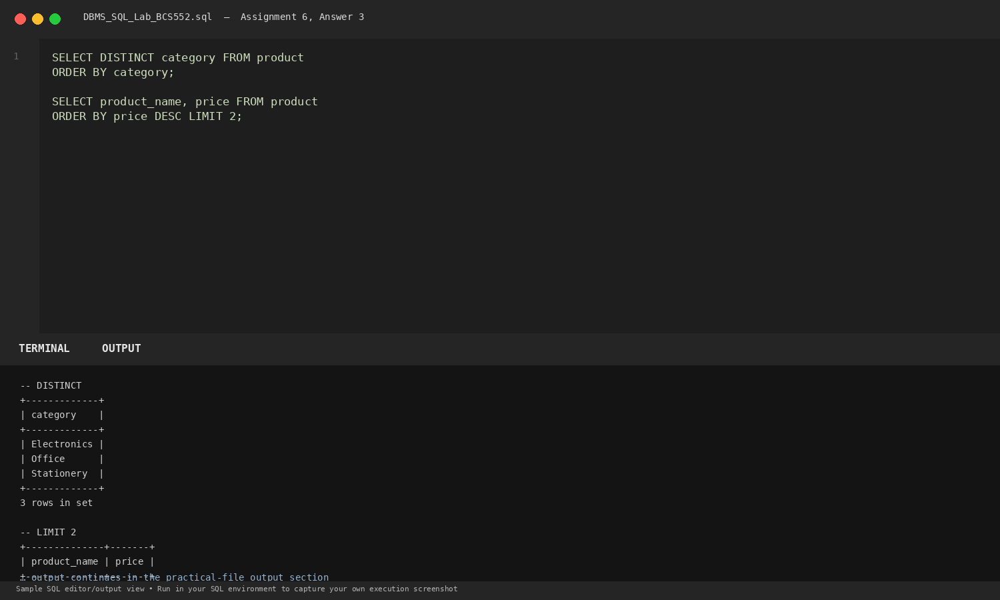

# Lab 6: Sorting Rows and Removing Repeats

**Course:** DBMS &amp; SQL Lab (BCS552)  
**Institution:** Invertis University Bareilly  
**Degree:** B.Tech CSE 5th Semester  
**Submitted By:** Usman Khan (Roll No.: 2410303518)  
**Submitted To:** Manish Choudhary  

---

## 🎯 Aim
Sort rows, remove repeated values and show selected rows.

## 🧠 Core Concepts
ORDER BY clause (ASC/DESC), eliminating duplicate rows using DISTINCT, and pagination with LIMIT.

---

## 💻 SQL Tasks &amp; Solutions

### Task 1: Set up the product table

**SQL Statement:**
```sql
CREATE TABLE product (
    product_name VARCHAR(30), category VARCHAR(20), price INT
);

INSERT INTO product VALUES
('Pen', 'Stationery', 15), ('Notebook', 'Stationery', 60),
('Calculator', 'Electronics', 850), ('Bag', 'Office', 500);
```

**Expected Output:**
```text
Query OK, 4 rows affected
```

**Explanation:**  
Initializes product items with names, departments, and price tags.

**Execution Output Screenshot:**  


---
### Task 2: Sort products by price descending

**SQL Statement:**
```sql
SELECT product_name, price FROM product
ORDER BY price DESC;
```

**Expected Output:**
```text
+--------------+-------+
| product_name | price |
+--------------+-------+
| Calculator   |   850 |
| Bag          |   500 |
| Notebook     |    60 |
| Pen          |    15 |
+--------------+-------+
4 rows in set
```

**Explanation:**  
ORDER BY price DESC sorts the output rows from highest price to lowest price.

**Execution Output Screenshot:**  


---
### Task 3: Show unique categories and top two products

**SQL Statement:**
```sql
SELECT DISTINCT category FROM product
ORDER BY category;

SELECT product_name, price FROM product
ORDER BY price DESC LIMIT 2;
```

**Expected Output:**
```text
-- DISTINCT categories
+-------------+
| category    |
+-------------+
| Electronics |
| Office      |
| Stationery  |
+-------------+
3 rows in set

-- LIMIT 2 highest priced products
+--------------+-------+
| product_name | price |
+--------------+-------+
| Calculator   |   850 |
| Bag          |   500 |
+--------------+-------+
2 rows in set
```

**Explanation:**  
DISTINCT eliminates duplicate category values. LIMIT 2 restricts the result set to the first two records after descending sort.

**Execution Output Screenshot:**  


---

## 🚀 How to Execute
1. Open MySQL / MariaDB terminal or any SQL client:
   ```bash
   mysql -u username -p
   ```
2. Execute the included SQL file:
   ```sql
   source queries.sql;
   ```
3. Or open `index.html` in your web browser to inspect the visual laboratory report.
