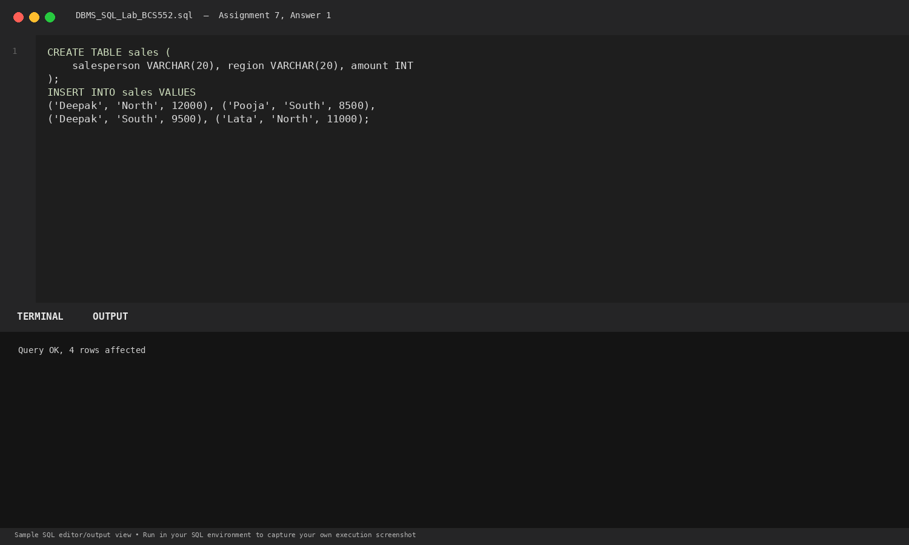
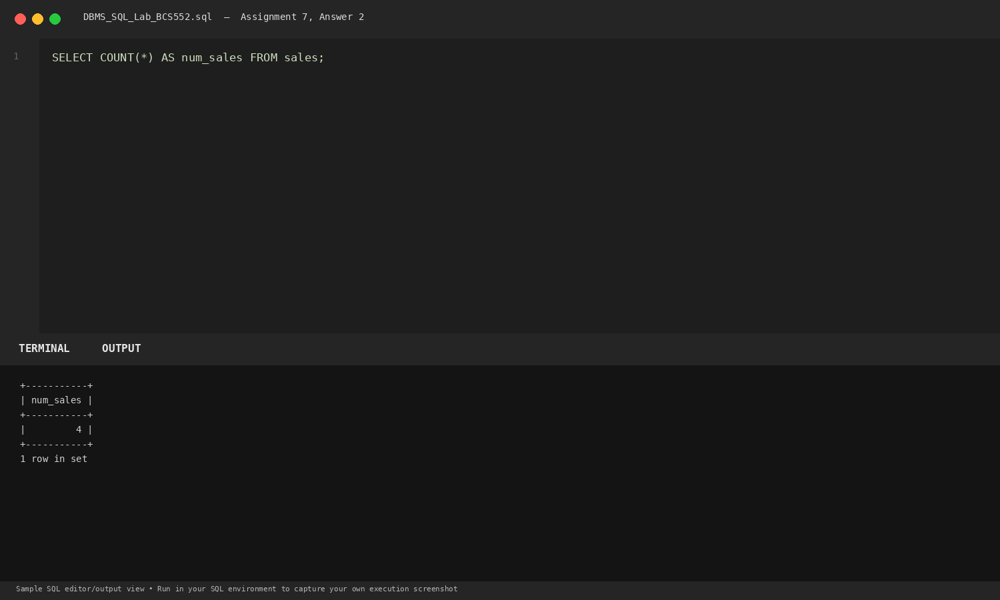
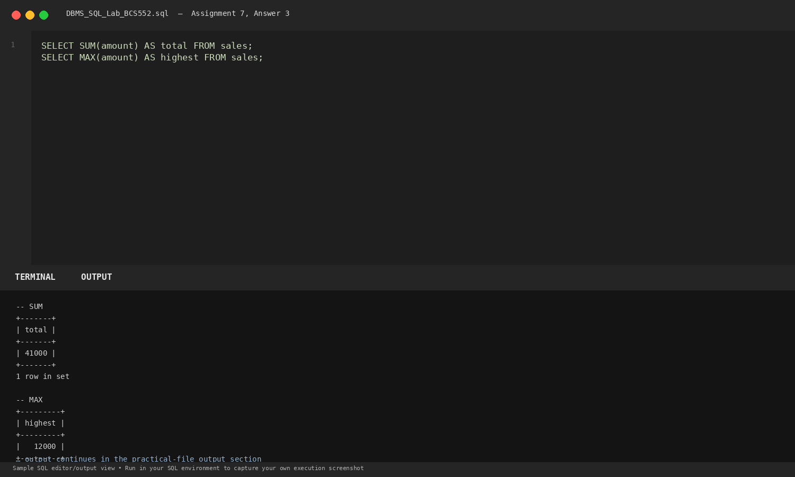

# Lab 7: Using Aggregate Functions

**Course:** DBMS &amp; SQL Lab (BCS552)  
**Institution:** Invertis University Bareilly  
**Degree:** B.Tech CSE 5th Semester  
**Submitted By:** Usman Khan (Roll No.: 2410303518)  
**Submitted To:** Manish Choudhary  

---

## 🎯 Aim
Use one aggregate function in each task.

## 🧠 Core Concepts
SQL Aggregate functions: COUNT(), SUM(), MAX(), and column aliasing with AS.

---

## 💻 SQL Tasks &amp; Solutions

### Task 1: Set up the sales table

**SQL Statement:**
```sql
CREATE TABLE sales (
    salesperson VARCHAR(20), region VARCHAR(20), amount INT
);

INSERT INTO sales VALUES
('Deepak', 'North', 12000), ('Pooja', 'South', 8500),
('Deepak', 'South', 9500), ('Lata', 'North', 11000);
```

**Expected Output:**
```text
Query OK, 4 rows affected
```

**Explanation:**  
Creates transactional sales table recording salesperson names, regions, and revenue amounts.

**Execution Output Screenshot:**  


---
### Task 2: Count sales rows

**SQL Statement:**
```sql
SELECT COUNT(*) AS num_sales FROM sales;
```

**Expected Output:**
```text
+-----------+
| num_sales |
+-----------+
|         4 |
+-----------+
1 row in set
```

**Explanation:**  
COUNT(*) tallies the total number of records present in the sales table.

**Execution Output Screenshot:**  


---
### Task 3: Calculate total and highest amount

**SQL Statement:**
```sql
SELECT SUM(amount) AS total FROM sales;
SELECT MAX(amount) AS highest FROM sales;
```

**Expected Output:**
```text
-- SUM
+-------+
| total |
+-------+
| 41000 |
+-------+
1 row in set

-- MAX
+---------+
| highest |
+---------+
|   12000 |
+---------+
1 row in set
```

**Explanation:**  
SUM() computes cumulative sales (12000+8500+9500+11000=41000). MAX() identifies the maximum single sale transaction (12000).

**Execution Output Screenshot:**  


---

## 🚀 How to Execute
1. Open MySQL / MariaDB terminal or any SQL client:
   ```bash
   mysql -u username -p
   ```
2. Execute the included SQL file:
   ```sql
   source queries.sql;
   ```
3. Or open `index.html` in your web browser to inspect the visual laboratory report.
