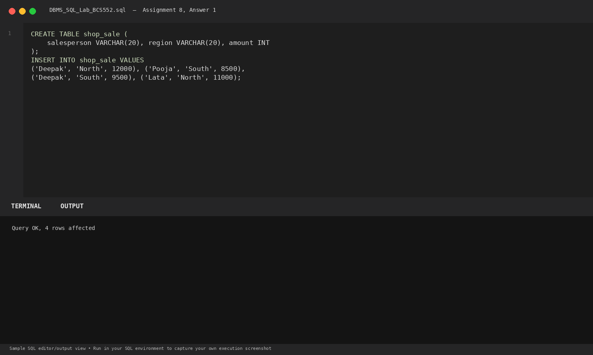
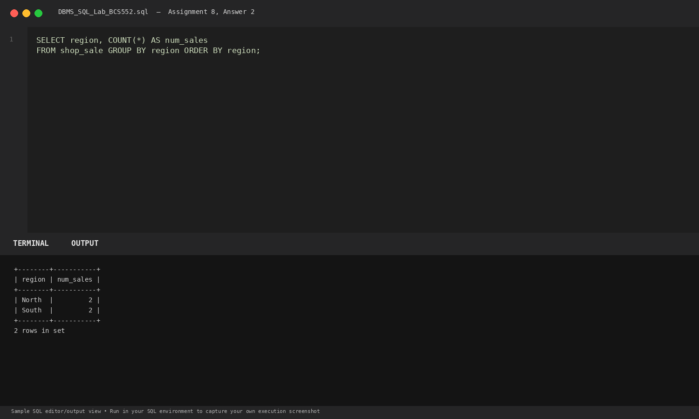
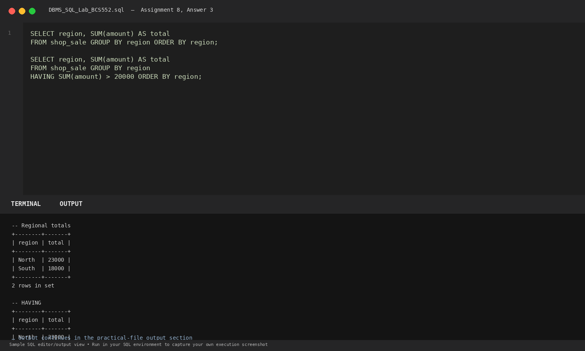

# Lab 8: Grouping Rows and Using HAVING

**Course:** DBMS &amp; SQL Lab (BCS552)  
**Institution:** Invertis University Bareilly  
**Degree:** B.Tech CSE 5th Semester  
**Submitted By:** Usman Khan (Roll No.: 2410303518)  
**Submitted To:** Manish Choudhary  

---

## 🎯 Aim
Group rows by region and check group totals.

## 🧠 Core Concepts
Data aggregation by partitions with GROUP BY, and post-aggregation condition filtering using HAVING.

---

## 💻 SQL Tasks &amp; Solutions

### Task 1: Set up the shop_sale table

**SQL Statement:**
```sql
CREATE TABLE shop_sale (
    salesperson VARCHAR(20), region VARCHAR(20), amount INT
);

INSERT INTO shop_sale VALUES
('Deepak', 'North', 12000), ('Pooja', 'South', 8500),
('Deepak', 'South', 9500), ('Lata', 'North', 11000);
```

**Expected Output:**
```text
Query OK, 4 rows affected
```

**Explanation:**  
Sets up sales figures categorized across geographical regions.

**Execution Output Screenshot:**  


---
### Task 2: Count sales in each region

**SQL Statement:**
```sql
SELECT region, COUNT(*) AS num_sales
FROM shop_sale GROUP BY region ORDER BY region;
```

**Expected Output:**
```text
+--------+-----------+
| region | num_sales |
+--------+-----------+
| North  |         2 |
| South  |         2 |
+--------+-----------+
2 rows in set
```

**Explanation:**  
GROUP BY partitions data into subsets based on unique region values and counts items per group.

**Execution Output Screenshot:**  


---
### Task 3: Show regional totals and use HAVING

**SQL Statement:**
```sql
SELECT region, SUM(amount) AS total
FROM shop_sale GROUP BY region ORDER BY region;

SELECT region, SUM(amount) AS total
FROM shop_sale GROUP BY region
HAVING SUM(amount) > 20000 ORDER BY region;
```

**Expected Output:**
```text
-- Regional totals
+--------+-------+
| region | total |
+--------+-------+
| North  | 23000 |
| South  | 18000 |
+--------+-------+
2 rows in set

-- HAVING SUM(amount) > 20000
+--------+-------+
| region | total |
+--------+-------+
| North  | 23000 |
+--------+-------+
1 row in set
```

**Explanation:**  
HAVING applies a predicate filter on aggregated group results after grouping, unlike WHERE which filters individual rows before grouping.

**Execution Output Screenshot:**  


---

## 🚀 How to Execute
1. Open MySQL / MariaDB terminal or any SQL client:
   ```bash
   mysql -u username -p
   ```
2. Execute the included SQL file:
   ```sql
   source queries.sql;
   ```
3. Or open `index.html` in your web browser to inspect the visual laboratory report.
