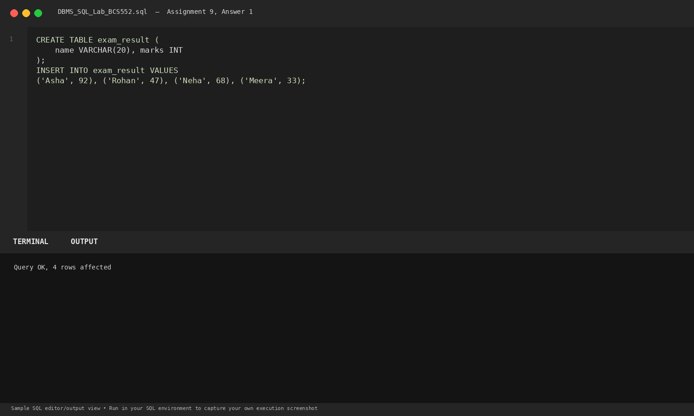
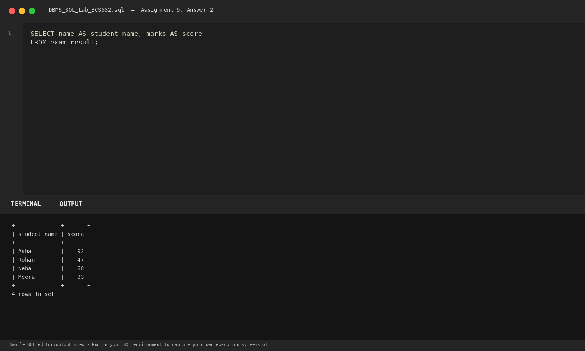
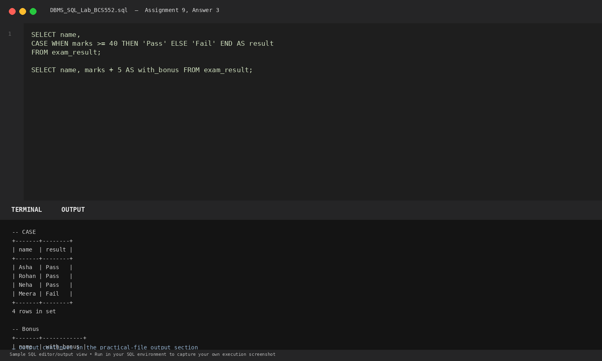

# Lab 9: Aliases and CASE

**Course:** DBMS &amp; SQL Lab (BCS552)  
**Institution:** Invertis University Bareilly  
**Degree:** B.Tech CSE 5th Semester  
**Submitted By:** Usman Khan (Roll No.: 2410303518)  
**Submitted To:** Manish Choudhary  

---

## 🎯 Aim
Rename columns and display a value selected by a condition.

## 🧠 Core Concepts
Column aliasing with AS, conditional control flow using CASE WHEN ... THEN ... ELSE ... END, and calculated arithmetic columns.

---

## 💻 SQL Tasks &amp; Solutions

### Task 1: Set up the exam_result table

**SQL Statement:**
```sql
CREATE TABLE exam_result (
    name VARCHAR(20), marks INT
);

INSERT INTO exam_result VALUES
('Asha', 92), ('Rohan', 47), ('Neha', 68), ('Meera', 33);
```

**Expected Output:**
```text
Query OK, 4 rows affected
```

**Explanation:**  
Initializes student exam scores.

**Execution Output Screenshot:**  


---
### Task 2: Use column aliases

**SQL Statement:**
```sql
SELECT name AS student_name, marks AS score
FROM exam_result;
```

**Expected Output:**
```text
+--------------+-------+
| student_name | score |
+--------------+-------+
| Asha         |    92 |
| Rohan        |    47 |
| Neha         |    68 |
| Meera        |    33 |
+--------------+-------+
4 rows in set
```

**Explanation:**  
Renames columns in the result set to student_name and score without modifying the underlying schema.

**Execution Output Screenshot:**  


---
### Task 3: Use CASE and add bonus marks

**SQL Statement:**
```sql
SELECT name,
CASE WHEN marks >= 40 THEN 'Pass' ELSE 'Fail' END AS result
FROM exam_result;

SELECT name, marks + 5 AS with_bonus FROM exam_result;
```

**Expected Output:**
```text
-- CASE
+-------+--------+
| name  | result |
+-------+--------+
| Asha  | Pass   |
| Rohan | Pass   |
| Neha  | Pass   |
| Meera | Fail   |
+-------+--------+
4 rows in set

-- Bonus
+-------+------------+
| name  | with_bonus |
+-------+------------+
| Asha  |         97 |
| Rohan |         52 |
| Neha  |         73 |
| Meera |         38 |
+-------+------------+
4 rows in set
```

**Explanation:**  
CASE evaluates conditional logic per row (marks >= 40 -> Pass, else Fail). marks + 5 computes an expression on the fly.

**Execution Output Screenshot:**  


---

## 🚀 How to Execute
1. Open MySQL / MariaDB terminal or any SQL client:
   ```bash
   mysql -u username -p
   ```
2. Execute the included SQL file:
   ```sql
   source queries.sql;
   ```
3. Or open `index.html` in your web browser to inspect the visual laboratory report.
